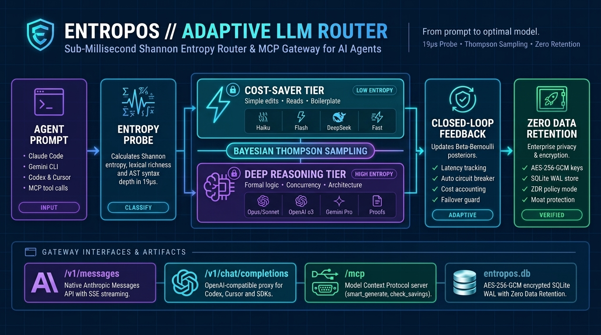

<div align="center">



# ENTROPOS — Adaptive LLM Complexity Router & MCP Gateway

[](https://www.npmjs.com/package/@falsable/entropos)
[](LICENSE)
[](#)
[](skills/entropos/SKILL.md)

<p align="center">
  <a href="#what-is-entropos"><b>What is Entropos?</b></a> •
  <a href="#use-with-claude-code-gemini-cli-or-codex"><b>🤖 Use with Your AI Agent</b></a> •
  <a href="#quick-start-npx"><b>Quick Start</b></a> •
  <a href="#connecting-clients--agents"><b>Connect Clients</b></a> •
  <a href="#persistence-encryption--zero-data-retention-zdr"><b>Zero Data Retention</b></a>
</p>

</div>

---

## What is `Entropos`?

**`Entropos` stops AI coding agents from burning expensive flagship model tokens on trivial prompts.**

When you run **Claude Code**, **Gemini CLI**, **Codex**, or **Cursor**, 60–80% of agent turns are low-complexity operations (reading files, formatting, simple edits, boilerplate) that do not require an expensive frontier reasoning model. **`Entropos` is a local MCP Gateway and drop-in Anthropic/OpenAI proxy** that optimizes cost and latency automatically:

1. **Sub-Millisecond Shannon Entropy Probe:** Measures every prompt's character/token Shannon entropy, lexical diversity, and syntactic branching factor in `<1 ms`—without calling an external classifier LLM.
2. **Closed-Loop Bayesian Thompson Sampling:** Combines complexity tiers (`low`, `medium`, `high`, `extreme`) with Beta-Bernoulli posteriors updated from real execution feedback to route each turn to the model with the best quality-to-cost ratio (Anthropic, OpenAI, Gemini, DeepSeek).
3. **Drop-In for Every Agent + Zero Data Retention (ZDR):** Exposes a native **Anthropic Messages API** (`/v1/messages` with SSE streaming for Claude Code), an **OpenAI-compatible proxy** (`/v1/chat/completions` for Codex/Cursor), and an **MCP Server** (`/mcp`), backed by SQLite WAL with AES-256-GCM key encryption and configurable Zero Data Retention.

---

## 🤖 Use with Claude Code, Gemini CLI, or Codex

Copy and paste this instruction directly into **Claude Code**, **Gemini CLI / Antigravity**, **OpenAI Codex**, or **Cursor** so your agent sets up and connects to `Entropos`:

```text
Set up and connect Entropos (@falsable/entropos) in this workspace:
1. Copy the official agent skill from https://raw.githubusercontent.com/falsable/Entropos/main/skills/entropos/SKILL.md into `.agents/skills/entropos/SKILL.md` and `.claude/skills/entropos/SKILL.md`, and read it.
2. Launch Entropos in the background with `npx @falsable/entropos --port 3000` (or `npm ci && npm run build && npm start` if working inside the Entropos repo) and verify `http://localhost:3000/healthz`.
3. Create a workspace key via `POST http://localhost:3000/api/keys` with `{"name": "agent-client"}`.
4. Configure our agent environment to route through Entropos (`ANTHROPIC_BASE_URL=http://localhost:3000` for Claude Code, `http://localhost:3000/v1` for OpenAI/Codex/Cursor, or `http://localhost:3000/mcp` in `mcp_config.json`).
```

### Install the Bundled Agent Skill (`SKILL.md`) Directly

Equip your coding agents with [`skills/entropos/SKILL.md`](skills/entropos/SKILL.md) so they know how to query `/v1/messages`, `/v1/chat/completions`, MCP tools (`smart_generate`, `get_optimal_model`, `check_savings`), and `A2DLC_LLM=entropos`:

```bash
mkdir -p .claude/skills/entropos .agents/skills/entropos
curl -fsSL https://raw.githubusercontent.com/falsable/Entropos/main/skills/entropos/SKILL.md -o .claude/skills/entropos/SKILL.md
cp .claude/skills/entropos/SKILL.md .agents/skills/entropos/SKILL.md
```

---

## Quick Start (`npx`)

Run the router, MCP gateway, and local telemetry console (`http://localhost:3000/app`) immediately:

```bash
npx @falsable/entropos --port 3000
```

Or run from source:

```bash
npm ci
cp .env.example .env     # configure GEMINI_API_KEY, ANTHROPIC_API_KEY, OPENAI_API_KEY, DEEPSEEK_API_KEY
npm run build
npm start                # http://localhost:3000
```

---

## How Routing Works

1. **Shannon Entropy & Structural Probe** (`src/lib/routerEngine.ts`, `calculateShannonEntropy`): Scores each prompt across character/token Shannon entropy, lexical diversity, syntactic depth, and logical branching factor to classify task complexity (`low`, `medium`, `high`, `extreme`).
2. **Closed-Loop Bayesian Selection** (`analyzeAndPickModel`): Combines the complexity tier, routing policy (`adaptive`, `balanced`, `cost_saver`, `max_quality`), and Beta-Bernoulli posteriors (Thompson Sampling) per model.
3. **Posterior Feedback Loop** (`updatePosteriorWithFeedback`): Execution outcomes update model posteriors in SQLite (`data/entropos.db`), exposed via `/api/adaptive-telemetry`.
4. **Multi-Provider Dispatch** (`src/server/dispatcher.ts`): Dispatches to Anthropic, OpenAI, DeepSeek, and Gemini (`src/server/modelCatalog.ts`), reporting the exact model and latency that served the request, with automatic circuit-breaking and failover.

---

## 📊 Measured Benchmarks & Verification

| Metric | Measured Result | Methodology / Verification |
|---|---|---|
| **In-Process Routing Overhead** (`calculateShannonEntropy` + `analyzeAndPickModel`) | **`0.019 ms` (`19 µs`) p50** · **`0.030 ms` p95** · **`0.052 ms` p99** | $n = 5,000$ iterations across mixed-complexity prompts (`src/lib/routerEngine.ts`, Node.js v24) |
| **External Classifier LLM Calls Required** | **`0`** | Pure mathematical probe + Beta-Bernoulli Thompson Sampling in-process |
| **Full-Lifecycle A2-DLC Slice Cost** (`A2DLC_LLM=entropos`) | **`$0.025 – $0.069 USD` per slice** | Measured across 6–8 role container dispatches (`N=1` & `N=2` tracks, Stages −1 to 7) |
| **Automated Contract, Security & ZDR Suite** | **`84 / 84` passing (`100%`)** | `npm test` — verifies Anthropic SSE streaming, OpenAI proxy, MCP tools, AES-256-GCM encryption at rest, SQLite WAL, and strict ZDR (`zero_retention`) |

> *Scope note:* Exact percentage cost savings on interactive coding sessions depend on your prompt complexity distribution (fraction of low/medium turns vs. deep reasoning turns) and configured provider catalog (`cost_saver` vs. `balanced`).

---

## Connecting Clients & Agents

### 1. Claude Code & Native Anthropic Clients (`/v1/messages`)
Entropos exposes a native **Anthropic Messages API** proxy (`POST /v1/messages` and `POST /messages`) supporting both JSON and **Server-Sent Events (SSE) streaming** (`message_start`, `content_block_delta`, `message_delta`, `message_stop`), accepting `x-api-key` or `Authorization: Bearer <workspace-key>`:

```bash
export ANTHROPIC_BASE_URL="http://localhost:3000"
export ANTHROPIC_API_KEY="<your-entropos-workspace-key>"
claude
```

### 2. OpenAI-Compatible Clients (`/v1/chat/completions`)
Point Codex, Cursor, Continue, or any OpenAI SDK client to `/v1`:
- `GET http://localhost:3000/v1/models`
- `POST http://localhost:3000/v1/chat/completions` (`Authorization: Bearer <workspace-key>`)

### 3. Model Context Protocol (`POST /mcp`, `GET /mcp/sse`)
Expose the `entropos-mcp` server to any MCP host with three built-in tools:

| Tool | Description |
|---|---|
| `smart_generate` | Routes and executes a task on the optimal model for the given routing preference |
| `get_optimal_model` | Returns the recommended model and complexity tier for a prompt without executing it |
| `check_savings` | Returns cumulative cost savings and routed request telemetry |

### 4. A2-DLC Role Container Integration (`A2DLC_LLM=entropos`)
When running [A2-DLC](https://github.com/falsable/a2dlc) (`a2dlc run`), role containers (Specifiers $\alpha/\beta$, Inquisitor, Saboteur, Builders) can route their inference and cost accounting through Entropos by setting `"A2DLC_LLM": "entropos"` in `.a2dlc/roles.json` (with `ENTROPOS_API_KEY` in `env_file` and `ENTROPOS_URL` pointing to the gateway).

---

## Monthly Budget Cap (`monthlyBudgetCapUsd`)

`monthlyBudgetCapUsd` (default `150`, set with `POST /api/settings` and an admin token) is enforced on `POST /v1/chat/completions`, `POST /v1/messages` (and `/messages`), and the MCP `smart_generate` tool (`POST /mcp`). Spend is the sum of the measured `costUsd` already recorded in route telemetry for the current calendar month (UTC); nothing is estimated. A cap of `0` (or a non-numeric value) disables enforcement.

- **Below 80% of the cap**: requests pass untouched.
- **From 80% of the cap**: requests still pass and carry an `X-Entropos-Budget-Warning` response header with the percentage used.
- **At or above the cap**: the request is refused with `429`, a `Retry-After` header (seconds until the reset), and a JSON body naming the cap and the spend. Nothing is sent upstream and nothing is recorded as spend.
- **Reset**: the window is the calendar month, so on the 1st at 00:00 UTC spend counts from zero again. Raising the cap unblocks traffic immediately.

Other MCP tools (`get_optimal_model`, `check_savings`) never spend and are not blocked. Requests without a valid workspace key still get `401` and never see the spend figures.

```json
{
  "error": {
    "type": "insufficient_quota",
    "code": "monthly_budget_exceeded",
    "message": "Monthly budget cap reached: $2.5000 spent of the $1.00 cap. Requests resume at 2026-11-01T00:00:00.000Z or when monthlyBudgetCapUsd is raised.",
    "monthly_budget_cap_usd": 1,
    "spent_usd": 2.5,
    "period_start": "2026-10-01T00:00:00.000Z",
    "resets_at": "2026-11-01T00:00:00.000Z"
  }
}
```

`/v1/messages` returns the same fields inside the Anthropic envelope (`{"type":"error","error":{"type":"rate_limit_error","code":"monthly_budget_exceeded",...}}`), and `/mcp` returns a JSON-RPC error (`code -32029`) with the fields under `error.data`.

---

## Persistence, Encryption & Zero Data Retention (ZDR)

`src/server/storage.ts` uses an embedded **SQLite WAL** engine (`node:sqlite` at `data/entropos.db`) for atomic $O(1)$ concurrent writes:

- **Encryption at Rest (AES-256-GCM)**: Provider API secrets (`providerSecrets`) are encrypted at rest with a 12-byte random IV and authentication tag derived from `STORAGE_ENCRYPTION_KEY` or `data/.entropos_secret` (`0600`).
- **Retention Policies (`retentionPolicy` via `GET`/`POST /api/settings`)**:

| Policy | Behavior | Target Use Case |
|---|---|---|
| `metadata_only` *(default)* | **Never stores** `fullPrompt` or `responseText`. Stores only analytical metadata (tokens, latency, chosen model, cost, savings) and a 60-char snippet. | Standard development and production |
| `zero_retention` | **Strict Zero Data Retention (ZDR)**: `fullPrompt`, `responseText`, and `promptSnippet` are empty on disk. Only anonymous quota and budget counters are kept. | Regulated / ISO 42001 enterprise environments |
| `full` | Stores full prompt and response text (requires explicit opt-in). | Local debugging and evaluation |

- **Moat Protection**: Internal routing variables (raw Shannon entropy bits, Thompson Sampling draws, posterior means) are never persisted to disk or leaked in public API responses.

---

## Endpoint Security

Two separate credential scopes protect the gateway:

1. **Admin Token (`ENTROPOS_ADMIN_TOKEN`)**: Guards console and management endpoints (`/api/settings`, `/api/diagnostics/*`, `/api/keys`, `/api/route`, `/api/chat`, `/api/probe`, `/api/feedback`, `/api/adaptive-telemetry/reset`) alongside per-IP rate limiters. In `NODE_ENV=production`, requests fail closed (`503`) if `ENTROPOS_ADMIN_TOKEN` is unset.
2. **Workspace Keys**: Used by client agents on `/v1/chat/completions`, `/v1/messages`, `/mcp`, and `/mcp/sse` via `Authorization: Bearer <key>` or `x-api-key`. Keys are generated once in the console (`GET /api/keys` exposes only the last 4 characters).

---

## Development & Verification

```bash
npm run lint     # tsc --noEmit (strict static typecheck)
npm test         # 84 automated tests (contracts, guards, ZDR, SQLite WAL, Anthropic SSE, moat security)
npm run build    # Vite SPA build + esbuild server bundle (dist/server.js)
a2dlc check      # Deterministic differential & property gate
```

## License

[Apache-2.0](LICENSE). © 2026 Aldemar Hernández · [falsable](https://github.com/falsable).


---

## Trademark Disclaimer

Anthropic, Claude, Claude Code, OpenAI, ChatGPT, Codex, Google, Gemini, Cursor and their respective logos are trademarks or registered trademarks of their respective owners. Entropos is an independent open-source project and is not affiliated with, endorsed by, sponsored by, or associated with Anthropic, PBC, OpenAI, Inc., Google LLC, or Anysphere, Inc.
